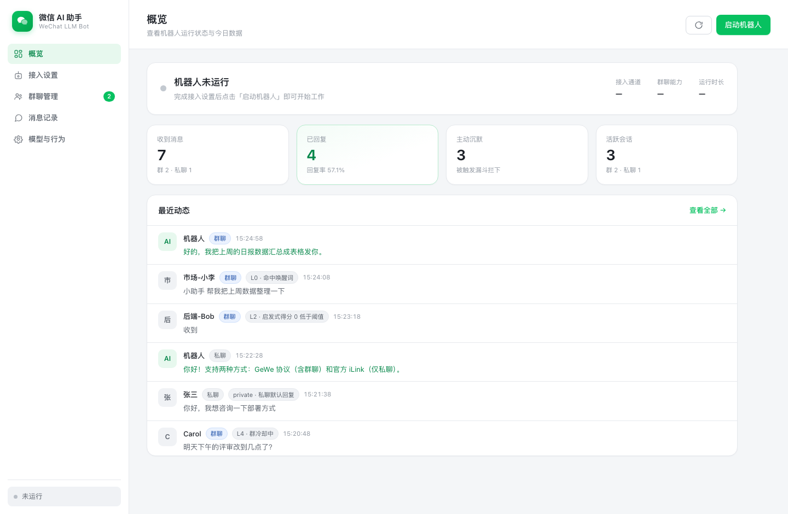
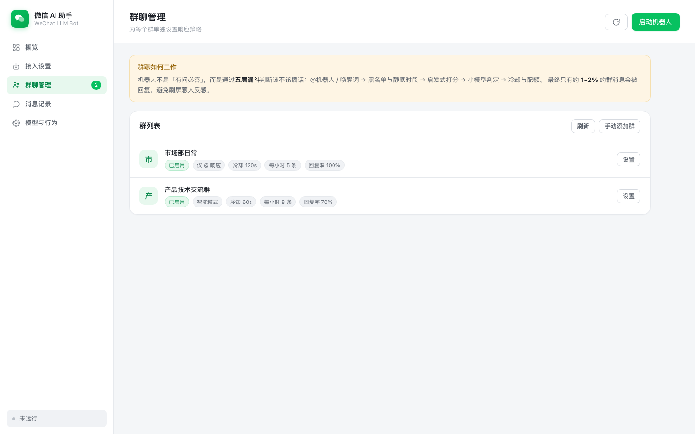
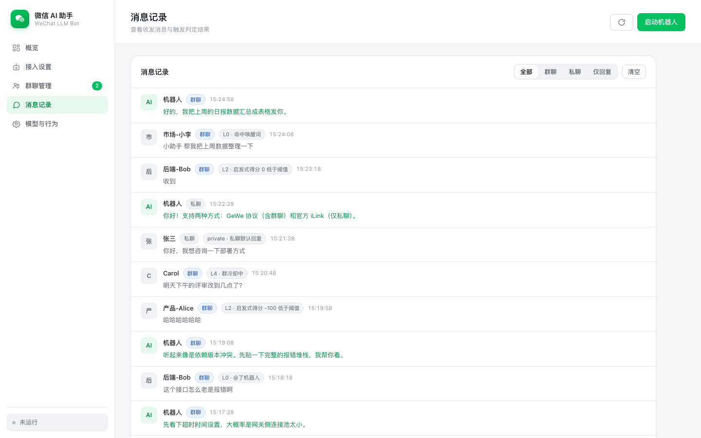
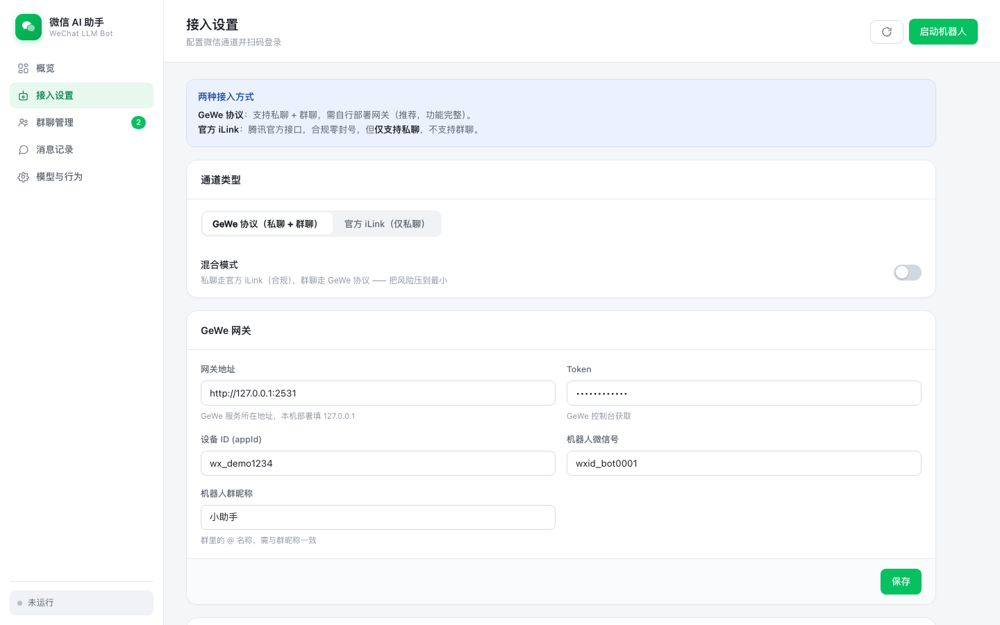
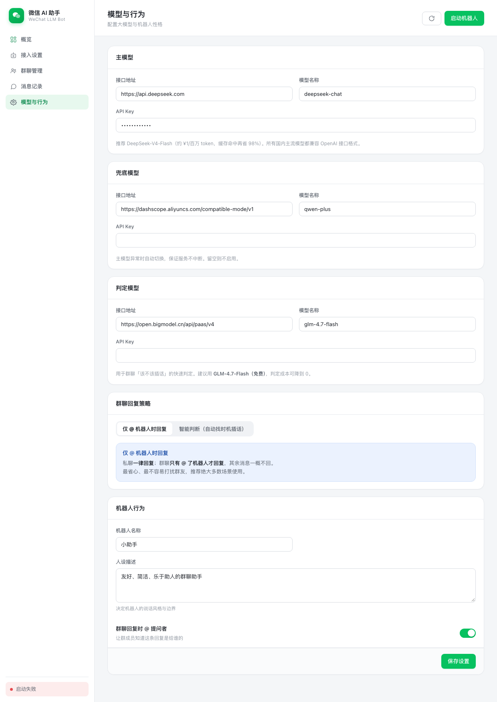

# 微信 AI 助手

一个接入大模型的微信对话机器人，**支持一对一私聊与群聊智能插话**。
自带美观的 Web 管理界面，**无需懂编程，双击即可运行**。

---

## 快速开始（三步）

### 1️⃣ 启动

| 你的系统 | 操作 |
|---|---|
| **Windows** | 双击 `start-windows.bat` |
| **macOS** | 双击 `start-mac.command` |
| **Linux** | 终端执行 `./start.sh` |

> 首次运行会自动安装依赖（约 1–2 分钟），之后每次启动只需几秒。
> 浏览器会自动打开管理界面 `http://127.0.0.1:8000`。

### 2️⃣ 配置

在界面左侧「**接入设置**」里：
- 填写 GeWe 网关地址与 Token
- 点击「获取登录二维码」，用手机微信扫码
- 登录成功后微信号会自动填入

在「**模型与行为**」里：
- 填写大模型 API Key（推荐 DeepSeek）
- 设置机器人的名字和性格

### 3️⃣ 启动

点右上角「**启动机器人**」，完成。

---

## 没有编程基础？先看这三条

**① 需要一个「协议网关」**
微信官方没有开放群聊接口，所以群聊功能需要搭配一个网关程序。
推荐用 **GeWe**（免费开源，Docker 一行命令启动）：

```bash
docker run -itd -p 2531:2531 -p 2532:2532 \
  --privileged=true --name=gewe \
  registry.cn-hangzhou.aliyuncs.com/gewe/gewe:latest
```

也可以直接用它提供的云端服务（无需自己部署），把「网关地址」填成
`https://api.geweapi.com/gewe` 即可。

**② 需要一个「大模型 API Key」**
到 [DeepSeek 开放平台](https://platform.deepseek.com/) 注册并充值（10 元够用很久），
复制 API Key 填进「模型与行为」页面。

**③ 群聊不会刷屏**
机器人不是「有问必答」。它用**五层漏斗**判断该不该插话，
最终只有约 **1~2%** 的群消息会被回复 —— 这是刻意设计的，避免惹人反感。

---

## 界面预览

| 页面 | 作用 |
|---|---|
| **概览** | 运行状态、今日数据、最近动态 |
| **接入设置** | 通道配置 + 扫码登录 |
| **群聊管理** | 为每个群单独设置响应策略 |
| **消息记录** | 每条消息的触发判定结果一目了然 |
| **模型与行为** | 大模型配置 + 机器人性格 |

### 概览



### 群聊管理



### 消息记录

每条消息都会标注**触发层级与原因**，一眼看清机器人为什么回、为什么不回：



### 接入设置



### 模型与行为（可切换群聊回复策略）




---

## 群聊是怎么工作的

默认策略是 **「仅 @ 机器人时回复」**：

```
消息到达
  │
  ├─ 私聊 ─────────────────────────→ 一律回复
  │
  ├─ 群聊，@ 了机器人 ─────────────→ 回复（并 @ 回提问者）
  │
  └─ 群聊，没 @ ───────────────────→ 不回复
```

**在「模型与行为」页可以切换成「智能判断」模式**，让机器人主动找时机插话：

```
群消息 → ① @机器人 / 唤醒词 ────→ 必回
        ↓ 没命中
        ② 黑名单 / 静默时段 ────→ 必不回
        ↓ 通过
        ③ 启发式打分（阈值 40 分）→ 拦掉约 80%
        ↓ 通过
        ④ 小模型判定该不该插话 ──→ 拦掉约 75%
        ↓ 通过
        ⑤ 冷却 / 配额 / 概率闸门 → 拦掉约 80%
        ↓
        最终约 1~2% 的消息被回复
```

| | 仅 @ 机器人（默认） | 智能判断 |
|---|---|---|
| 私聊 | ✅ 一律回复 | ✅ 一律回复 |
| 群聊 @ 机器人 | ✅ 回复 | ✅ 回复 |
| 群聊未 @ | ❌ 一律不回 | ⚠️ 可能被漏斗捞起来 |
| 唤醒词 / 启发式 / 小模型 | 不启用 | 启用 |
| 默认冷却 | 不限速（@ 了必回） | 60 秒 |

> **为什么默认选「仅 @」**：用户 @ 了机器人却因为概率或冷却没被回复，体验很差，会让人以为机器人坏了。
> 所以这个模式下**不做任何限速与概率控制 —— @ 了必回**。想限速可以在界面上自己设。

**成本控制**：智能模式的判定用免费模型（GLM-4.7-Flash），回答用便宜模型（DeepSeek-V4-Flash）。
日均 2000 条群消息的场景下，判定成本为 **0 元**。

---

## 两种接入方式的区别

| | GeWe 协议 | 官方 iLink |
|---|---|---|
| 私聊 | ✅ | ✅ |
| **群聊** | ✅ | ❌ **不支持** |
| 合规性 | ⚠️ 逆向协议 | ✅ 腾讯官方 |
| 封号风险 | 中（用专用号可控制） | **无** |
| 部署 | 需自建网关 | 装插件即可 |

> **官方 iLink Bot API 是腾讯 2026 年开放的正规接口，合规零封号，但至今不支持群聊**（源码能力声明为 `chatTypes: ["direct"]`，已三重验证）。详见 [`docs/官方iLink-Bot-API-接入说明.md`](docs/官方iLink-Bot-API-接入说明.md)。
>
> 界面里的「**混合模式**」可以两者兼得：**私聊走官方（合规），群聊走协议（承担风险）**。

---

## 其他启动方式

### Docker 一键部署

```bash
docker compose up -d
# 打开 http://127.0.0.1:8000
```

会自动启动「协议网关 + 主程序」两个容器。本应用零外部依赖，**不需要数据库**。

### 命令行

```bash
pip install -r requirements.txt
python -m src.server
```

### 环境变量

| 变量 | 默认值 | 说明 |
|---|---|---|
| `WXBOT_PORT` | `8000` | 服务端口（被占用时自动顺延） |
| `WXBOT_HOST` | `127.0.0.1` | 监听地址 |
| `WXBOT_DATA_DIR` | `./data` | 数据目录（配置 + 消息记录） |
| `WXBOT_NO_BROWSER` | — | 设为 `1` 则不自动打开浏览器 |

---

## 数据与隐私

- 所有配置和消息记录都保存在本机 `data/` 目录，**不上传任何服务器**
- 配置文件 `data/config.json` 里含 API Key，权限已收紧为仅本人可读
- 群聊上下文**默认不写入长期记忆**，仅保留 30 分钟会话窗口
- 想备份或迁移，直接拷贝 `data/` 目录即可

---

## 项目结构

```
start-windows.bat / start-mac.command / start.sh   一键启动脚本
docker-compose.yml / Dockerfile                    容器部署
requirements.txt                                   依赖清单
docs/
  微信LLM机器人技术方案.md                          完整技术方案
  官方iLink-Bot-API-接入说明.md                     官方 API 深度解析
src/
  server.py            Web 服务（管理界面 + API）
  runtime.py           机器人运行时（启停/状态/日志/扫码）
  config_store.py      配置持久化（原子写入 + 密钥掩码）
  web/                 管理界面（index.html / style.css / app.js）
  core/
    types.py           统一消息结构
    group.py           群聊语义（@检测 / 群昵称 / 发送者解析）
    trigger.py         五层触发漏斗
    context.py         上下文装配与压缩
    llm.py             大模型网关（路由/降级）
    sender.py          拟人化发送（限流/延迟/分段）
  adapters/
    base.py            适配器契约
    gewechat.py        GeWe 协议（私聊 + 群聊）
    ilink.py           官方 iLink（仅私聊）
    hybrid.py          混合路由
  store_memory.py      会话存储
  orchestrator.py      编排层
  demo.py              触发判定演示
  demo_group.py        群聊端到端演示
  verify_ilink.py      官方 API 验证
  verify_group.py      群聊功能验证
```

---

## 开发者：跑测试

```bash
python -m src.demo          # 触发判定演示（无需依赖）
python -m src.demo_group    # 群聊端到端演示
python -m src.verify_group  # 群聊功能验证（24 项）
python -m src.verify_ilink  # 官方 API 验证（含真实接口联调）
```

---

## ⚠️ 使用须知

- **群聊走的是协议方案**，违反微信平台协议，存在账号被风控的可能。请务必使用**专用小号**，不要用主号。
- 官方 iLink 通道合规、零封号，但腾讯保留随时调整或终止服务的权利（条款 7.2），建议保留降级通道。
- 请勿用于营销群发、骚扰等违规用途。
- 请遵守《生成式人工智能服务管理暂行办法》，使用已备案的国内大模型服务。
